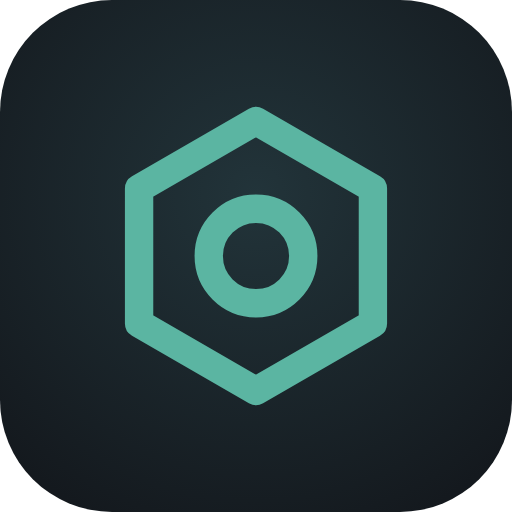

<p align="center"></p>

# Oxidian

[Web](https://jvlsile.github.io/oxidian/?lang=es) · **Español** · [English](README.md)

> **🧪 Beta pública.** Oxidian es nuevo y puede tener fallos. Si encuentras alguno, pulsa **Reportar un fallo** en el menú lateral del panel o [abre un issue](https://github.com/jvlsile/oxidian/issues/new/choose): ayuda muchísimo.

> El panel es gratuito y de código abierto. Si te resulta útil, puedes apoyar el proyecto en [Ko-fi](https://ko-fi.com/oxidian).

Panel web para **instalar y administrar servidores dedicados de Rust**, con instalador de plugins (uMod) y funciones de administración. Funciona en **Windows y Linux** y está disponible en **español, inglés, portugués y francés**.

## Funciones

| Sección | Qué hace |
|---|---|
| **Servidores existentes y alquilados** | Importa un servidor que ya tengas en el mismo equipo (lee tu `.bat`/`.sh` y respeta mapa y plugins) o conéctate a un **servidor alquilado por RCON** solo con la IP, el puerto y la contraseña. Añade acceso FTP/SFTP para gestionar también sus plugins. |
| **Instalación** | Elige **Windows o Linux**. Descarga SteamCMD e instala/actualiza el servidor (AppID 258550), ramas `public`/`staging`/`aux`. Instala **Oxide (uMod)** o **Carbon** con un clic, o vuelve a vanilla. **Barra de progreso** con porcentaje, fase, datos descargados y tiempo restante. |
| **Panel** | Estado, jugadores/cola, FPS, entidades, CPU y RAM, uptime, red. Mensaje global, guardar mundo, reinicio con avisos, forzar cierre. |
| **Estadísticas** | Jugadores conectados en el tiempo, pico y media, jugadores distintos, nuevos y que vuelven, horas jugadas, **mapa de calor por día y hora**, actividad diaria, FPS y entidades, rankings de tiempo jugado y de bajas. Por 24 h, 7, 30 o 90 días o **este wipe**. |
| **Rendimiento** | Mide cada **arranque** por fases (archivos, mapa, subida a Facepunch, plugins) y da consejos para acelerarlo (antivirus, disco, RAM, plugins). **Prioridad alta** del proceso. **Alertas** de FPS bajos, RAM alta y servidor colgado, con aviso en Discord y reinicio automático opcional. |
| **Bot de Discord** | Chat del juego ↔ canal de Discord, comandos `/estado`, `/jugadores`, `/wipe` y, para el staff, `/say`, `/kick`, `/ban`, `/vip`, `/tickets`. Jugadores conectados en el perfil del bot. Sin dependencias extra. |
| **Web pública** | Página para tus jugadores sin login en `/server`: estado, **botón para conectar**, cuenta atrás del wipe, PvP/PvE y rates, actividad de la semana, mapa con monumentos y rutas (sin posiciones de jugadores), rankings, normas y enlaces. En 4 idiomas. |
| **Consola** | Log del servidor en tiempo real (filtros servidor/chat/panel, búsqueda) y envío de comandos RCON con historial (↑/↓). |
| **Jugadores** | Lista de conectados, expulsar, banear/desbanear, dar admin (`ownerid`) o moderador, dar objetos, lista de baneados. |
| **Chat** | Historial del chat global, de equipo y privado, con búsqueda y filtros. Mensajes a todos o privados desde el panel. **Filtro de palabras** con comodines que puede **bloquear el mensaje antes de que se publique**. |
| **Moderación** | Por jugador: notas internas, advertencias con **sanciones automáticas** (expulsar, silenciar, baneo temporal o permanente al llegar a N), **silencio** y **baneo temporal** con fin automático. |
| **Reportes F7** | Cada F7 del juego abre un **ticket** (agrupado por jugador reportado). Asignación, notas del staff, cierre con sanción (advertencia, silencio, expulsión, baneo temporal o permanente) y **mensaje de agradecimiento** a quien reportó. `/tickets` en Discord. |
| **VIP con caducidad** | Mete a un jugador en un grupo de Oxide/Carbon durante X días y lo **saca solo al caducar**. Avisos en el juego (alta, 24 h antes y fin), ampliar o quitar, historial y `/vip` en Discord. |
| **Tienda Tebex** | Las compras se entregan solas: el panel consulta la cola de Tebex, ejecuta los comandos de cada paquete por RCON y los marca como entregados, sin plugin ni puertos abiertos. `oxidian.vip {id} vip 30` da VIP con caducidad. Agradecimiento en el chat, aviso en Discord y tabla de entregas. |
| **Staff en el juego** | Escribiendo `/staff` en Rust, moderadores y admins abren una ventana con jugadores, reportes F7 y (admins) mundo: advertir, silenciar, expulsar, banear, ir hacia/traer, curar, hora, clima y eventos. Dos niveles (`oxidian.mod` / `oxidian.admin`) que asigna el panel; todo queda en el registro como `ingame:Nombre`. |
| **Wiki** | Guía integrada de todas las funciones, con índice y buscador, en cada idioma. |
| **Idiomas** | Selector en el menú lateral y en la pantalla de acceso. Idioma aparte para los avisos del chat del juego y de Discord. |
| **Mapa en vivo** | Mapa del servidor con jugadores en tiempo real (colores por equipo), durmientes, eventos (Cargo, helicóptero, Bradley, Chinook), **carreteras, vías, ríos y tendido eléctrico**, monumentos con icono, leyenda y cuadrícula de Rust. Zoom, búsqueda y acciones al hacer clic. |
| **Equipos** | Equipos con sus miembros, alerta si superan el límite (p. ej. «Max 3») y detección de grupos que comparten armarios para saltárselo. |
| **Perfiles de Steam** | Al conectarse, comprueba baneos VAC o de juego, antigüedad de la cuenta, perfil privado y horas en Rust. Por regla: no hacer nada, avisar o expulsar. Lista blanca. |
| **Administradores** | Varios usuarios con roles (propietario, administrador, moderador, observador), **verificación en dos pasos (TOTP)** con códigos de recuperación y registro de actividad de quién hizo qué. |
| **Baneos compartidos** | Oxidian hace de servidor del **Centralized Banning** oficial de Rust: un baneo en un servidor vale para todos, también en vanilla y sin plugins. Una clave secreta por servidor y listas externas opcionales (otro Oxidian, Server Armour) en modo aviso o bloqueo. |
| **Vigilancia** | Alertas en tiempo real de posibles trampas y comportamientos extraños, ranking de jugadores a vigilar, historial por jugador y avisos en Discord. Detección de VPN, proxy, IPs de hosting y país. |
| **Inventarios** | Visor del inventario de cualquier jugador (conectado o durmiendo) con la **imagen de cada objeto**: ropa, cinturón y mochila, con estado, munición, accesorios y skins. Quitar objetos o vaciar el inventario. |
| **Rates y mundo** | **PvP/PvE en un clic** sin reiniciar. Multiplicadores de recolección, recogida, canteras y velocidad de crafteo con preajustes (1x, 2x, 3x, 5x, 10x). Decay, upkeep, radiación, estabilidad y tiempo de la caja bloqueada. **Hora del día**, **clima** y **eventos** (carguero, helicóptero, lanzamiento aéreo, Chinook). |
| **Plugins** | Buscador de **uMod** con instalación en un clic, subida de `.cs` (arrastrar y soltar), activar/desactivar, recargar, borrar (con o sin datos), **editor de configuración JSON** y **comprobación de actualizaciones**. |
| **Permisos** | Conceder/revocar permisos a usuarios o grupos, crear grupos, añadir usuarios a grupos, consultar (Oxide y Carbon). |
| **Configuración** | Nombre, descripción, imagen, mapa (procedural, Barren, islas), tamaño, semilla, puertos, RCON, PvE, tickrate, argumentos extra, autoarranque y reinicio automático tras caída. |
| **Programador** | Reinicios diarios a horas fijas con avisos en el chat (60/30/15/10/5/3/2/1 min), backup y actualización automáticos en cada reinicio, anuncios periódicos. |
| **Planificador de wipes** | Calcula el **wipe forzado de Facepunch** (primer jueves de cada mes, 19:00 de Londres) y lo hace solo, más wipes semanales o quincenales. Cuenta atrás, avisos en el chat (24 h, 1 h y últimos minutos) y en Discord, copia previa, actualización del servidor y Oxide/Carbon, semilla nueva y planos según la regla que elijas. |
| **Backups y wipe** | Copias ZIP (mapa, datos de jugadores, plugins, configs), descarga, restauración, rotación automática. Wipe de mapa o completo (con planos) con nueva semilla. |

## Requisitos

- **Windows** 10/11 o Windows Server 2019+, **o Linux** (Ubuntu 22.04/24.04, Debian 12), siempre de 64 bits.
- Node.js 18.20 o superior (recomendado 20 o 22 LTS) (el instalador de Windows lo instala con winget si falta).
- Unos 12 GB de RAM libres para un mapa de 3500 y 20 GB de disco.

## Descarga

Descarga la [última versión](https://github.com/jvlsile/oxidian/releases/latest) o clona el repositorio con `git clone https://github.com/jvlsile/oxidian.git`.

## Instalación en Windows

1. Descomprime `oxidian.zip` en una carpeta, por ejemplo `C:\Oxidian`.
2. Clic derecho en **`install-windows.ps1`** y elige **Ejecutar con PowerShell**. El script:
   - instala Node.js LTS si no lo tienes,
   - instala las dependencias del panel,
   - abre en el Firewall de Windows los puertos 28015/UDP, 28017/UDP, 28082/TCP y 8080/TCP,
   - opcionalmente, crea una tarea programada para que el panel arranque con Windows.
3. Se abre `http://localhost:8080` en el navegador: crea tu usuario propietario.

Para arrancarlo a mano en cualquier momento: doble clic en **`start-windows.bat`**.

> Si juegas con amigos desde fuera de tu red, redirige en el router los puertos 28015/UDP, 28017/UDP y 28082/TCP hacia la IP local de tu PC.

## Instalación en Linux

```bash
unzip oxidian.zip && cd oxidian
sudo bash install.sh
```
Crea el usuario `rustserver`, instala dependencias y Node.js, deja el panel como servicio `systemd` en el puerto 8080 y abre los puertos en `ufw`.

## Elegir Windows o Linux

En **Instalación → Sistema operativo del servidor** eliges para qué sistema se descargan los archivos de Rust, Oxide y Carbon. Por defecto se usa el sistema donde corre el panel.

- Lo normal es dejar el mismo sistema en el que ejecutas el panel.
- Puedes elegir el otro para **preparar** un servidor (por ejemplo, descargar la versión Linux desde tu PC con Windows y subirla a un VPS). En ese caso el panel avisa de que no puede arrancarlo en ese equipo.
- El panel ajusta solo los comandos de firewall que muestra, el ejecutable (`RustDedicated.exe` o `RustDedicated`), la forma de leer el registro del servidor y la medición de CPU/RAM.

## Primeros pasos

1. **Instalación → Instalar servidor** (la primera descarga ocupa unos 10 GB).
2. Opcional: **Instalar Oxide** o **Instalar Carbon** para usar plugins.
3. Ajusta nombre, mapa y jugadores en **Ajustes del servidor** y pulsa **Iniciar**.
4. Generar el mapa tarda unos minutos; cuando el indicador pasa a **En marcha**, se activan jugadores, plugins y permisos.

## Servidores existentes y alquilados

**En el mismo equipo.** Instalación → *Ya tengo uno en este equipo*: indica la carpeta donde está `RustDedicated` y pulsa **Detectar**. Oxidian lee tu script de arranque (`.bat`, `.cmd`, `.sh`) y el `server.cfg` para usar los mismos puertos, identidad, contraseña de RCON, nombre, mapa y semilla, y conserva tus demás parámetros. No se reinstala ni se borra nada. Si el servidor ya está encendido, el panel se conecta a él.

**Servidor alquilado (modo remoto).** Instalación → *Servidor alquilado (RCON)*: pon la IP, el puerto RCON y la contraseña de tu hosting. Funciona todo lo que va por RCON: consola, jugadores, chat, moderación, tickets F7, `/staff`, vigilancia, estadísticas, bot de Discord, Tebex, VIP, rates, mundo y web pública. Instalar, copias y wipes siguen en tu hosting.

**Acceso FTP/SFTP (opcional).** En modo remoto, añade los datos FTP, FTPS o SFTP de tu hosting y la carpeta que contiene `RustDedicated`, y pulsa **Probar**. A partir de ahí **Plugins** funciona como siempre (instalar desde uMod, subir, activar/desactivar, editor de configuración) y el panel sube y actualiza `OxidianBridge.cs` solo. Sin él, descarga `OxidianBridge.cs` desde el panel y súbelo a `oxide/plugins` o `carbon/plugins` con el gestor de archivos del hosting. Mejor SFTP: el FTP sin TLS envía la contraseña sin cifrar.

 Los reinicios programados avisan, guardan y cierran el servidor para que el hosting lo vuelva a arrancar.

## Actualizar

El panel mira cada 6 horas si hay una versión nueva publicada en GitHub y, si la hay, muestra **Nueva versión** en el menú lateral. Solo avisa: no descarga ni instala nada por su cuenta. Se desactiva en **Cuenta → Actualizaciones del panel** o con la variable `OXIDIAN_NO_UPDATE_CHECK=1`.

Para actualizar: detén el panel, sustituye los archivos por los de la versión nueva (conserva las carpetas `data/`, `server/`, `steamcmd/` y `backups/`), ejecuta `npm install --omit=dev` y vuelve a arrancarlo.

## Puertos

| Puerto | Protocolo | Uso |
|---|---|---|
| 28015 | UDP | Juego |
| 28017 | UDP | Query (lista de servidores) |
| 28016 | TCP | RCON: **no hace falta abrirlo**, el panel se conecta en local |
| 28082 | TCP | Rust+ (app del móvil) |
| 8080 | TCP | Panel web |

## Vigilancia e inventarios

Con **Oxide o Carbon**, el panel instala automáticamente su complemento **OxidianBridge** (`oxide/plugins/OxidianBridge.cs`). Si ya tenías el framework instalado, pulsa **Instalar complemento** en Vigilancia. Este complemento:

- permite ver y editar inventarios desde el panel (solo se puede usar por RCON, nunca desde el juego);
- envía al panel los eventos que analiza la vigilancia.

| Detección | Necesita | Qué mira |
|---|---|---|
| Disparos a la cabeza | Complemento | % de impactos a la cabeza sobre los últimos 50 impactos a jugadores (por defecto, alerta a partir del 60 % con 25 impactos o más) |
| Distancia anormal | Complemento | Impactos más lejos de lo razonable para el arma (350 m rifles, 150 m pistolas, subfusiles, escopetas y arcos) |
| Antihack | Complemento | Infracciones del antihack nativo de Rust (FlyHack, SpeedHack, NoClip, EyeHack…) acumuladas en 10 minutos |
| Ritmo de bajas | Complemento | Jugadores abatidos en 10 minutos |
| Reportes F7 | Complemento | Cada reporte; alerta grave si lo reportan 3 jugadores distintos en 1 hora |
| IP compartida | Nada (vanilla) | Cuentas distintas conectadas desde la misma IP |
| Evasión de baneo | Nada (vanilla) | Cuenta nueva desde la IP de un jugador baneado |
| Registro del servidor | Nada (vanilla) | Expulsiones y avisos del antihack en el log |

Todos los umbrales se ajustan en **Vigilancia → Umbrales de detección**. Ninguna alerta es una prueba de trampas: el lag provoca infracciones de antihack falsas y los buenos jugadores aciertan mucho. Úsalas para saber a quién observar (por ejemplo, espectando con `spectate`) antes de banear.

**Discord:** pega la URL de un webhook (Ajustes del canal → Integraciones → Webhooks), elige desde qué gravedad avisar y pulsa **Enviar prueba**.

## Administradores y roles

| Rol | Qué puede hacer |
|---|---|
| Propietario | Todo, incluido gestionar administradores |
| Administrador | Todo excepto gestionar administradores |
| Moderador | Ver el panel, expulsar, banear, escribir en el chat, ver inventarios y revisar alertas |
| Observador | Solo ver |

Los permisos se comprueban en el servidor, no solo ocultando botones. El **registro de actividad** guarda cada acción con usuario, fecha, objetivo y resultado, incluidos los intentos sin permiso; nunca guarda contraseñas ni claves.

**Si actualizas desde una versión anterior** (una sola contraseña): tu usuario es `admin` con la misma contraseña.

**Contraseña olvidada:** otro propietario puede cambiarla en Administradores. Si el único propietario la olvida, detén el panel, borra la lista `"users"` de `data/config.json` y al entrar podrás crear un propietario nuevo.

## Baneos compartidos

**Baneos compartidos** convierte el panel en un servidor del [Centralized Banning](https://wiki.facepunch.com/rust/centralized-banning) de Rust. Al activarlo, el panel configura `server.bansServerEndpoint` en su servidor. Para otros servidores, pon la dirección pública del panel, añade un servidor para obtener su comando (cada uno con su propia clave de 256 bits, que puedes cambiar o quitar) y pégalo en su consola y su `server.cfg`. La lista incluye los baneos del servidor, los añadidos en el panel y, si quieres, los silencios. Se pueden consultar listas externas con el mismo formato en modo aviso o bloqueo; solo se envía el SteamID. Por defecto, si el panel está apagado los jugadores pueden entrar igualmente, así que tus servidores nunca dependen de él.

## Detección de VPN y país

**Vigilancia → VPN, proxy y país** comprueba la IP de cada jugador al entrar con [proxycheck.io](https://proxycheck.io) (clave gratuita, 1.000 consultas al día) o ip-api.com (sin clave, solo uso no comercial). Para VPN/proxy, IPs de hosting y país puedes no hacer nada, avisar o expulsar, con lista de países a bloquear o permitir y lista blanca de SteamIDs o IPs. Los resultados se guardan 3 días en `data/ipcheck.json`.

## Comprobación de perfiles de Steam

Necesita una clave gratuita de la API web de Steam: <https://steamcommunity.com/dev/apikey>. Pégala en **Vigilancia → Comprobación de perfiles de Steam**. La clave se guarda solo en el servidor y nunca se envía a la interfaz. Los resultados se guardan 24 h en `data/steam.json`.

## Mapa en vivo

El complemento OxidianBridge pide al servidor que dibuje el mapa (la primera vez tarda unos segundos) y el panel lo guarda en `data/map/`. Se vuelve a generar solo tras un wipe o un cambio de semilla. Las posiciones se actualizan cada 3 segundos mientras el mapa está abierto.

## Bot de Discord

1. Crea una aplicación en <https://discord.com/developers/applications>, ve a **Bot**, pulsa **Reset Token** y copia el token.
2. En esa página activa **Message Content Intent**.
3. En Discord activa el modo desarrollador y copia el ID del canal donde quieres el chat.
4. En **Bot de Discord** pega el token y el ID, activa el bot y guarda. Cuando ponga «Conectado», usa **Invitar el bot a tu Discord**.

El token se guarda solo en `data/config.json` y nunca se envía a la interfaz. `/say`, `/kick`, `/ban`, `/vip` y `/tickets` solo aparecen a quien puede expulsar miembros en tu Discord, y cada acción queda en el registro de actividad. El chat de equipo nunca se publica y el filtro de palabras también se aplica a lo que llega desde Discord.

## Web pública

Actívala en **Web pública**: queda en `http://tu-ip:8080/server`. Solo muestra datos pensados para los jugadores; nunca posiciones en vivo, IP, SteamID ni moderación, y los nombres de los conectados solo si lo activas. Para verla desde fuera de tu red, abre el puerto del panel o, mejor, ponlo detrás de un proxy con HTTPS.

## Rendimiento y arranque

- Cada arranque se mide leyendo el registro del servidor: tiempo total hasta «Server startup complete» y la duración de cada fase. Los últimos 30 arranques y avisos se guardan en `data/perf.json`.
- **Para arrancar más rápido en Windows:** añade una excepción del antivirus para la carpeta `server` del panel y permite que `RustDedicated.exe` salga a Internet (si no, la subida del mapa a Facepunch agota el tiempo varias veces).
- **Prioridad alta:** en Windows se aplica directamente; en Linux necesita que el panel tenga permisos de administrador (si no, se usa «por encima de lo normal»).
- **Alertas:** FPS por debajo de un umbral durante X minutos, RAM del servidor por encima de un % del equipo y servidor colgado (proceso vivo sin responder por RCON). Reinicio automático opcional.

## Estadísticas

El panel guarda una muestra cada 5 minutos (jugadores, cola, FPS, entidades, CPU y RAM) y el tiempo jugado de cada jugador cada minuto, mientras el servidor está en marcha. Todo se queda 90 días en `data/stats.json`. Las bajas y los porcentajes a la cabeza necesitan Oxide o Carbon con el complemento OxidianBridge. «Este wipe» cuenta desde el último wipe, manual o automático.

## Planificador de wipes

- **Wipe forzado:** primer jueves de cada mes a las 19:00 (Europa/Londres; 20:00 en España), con el cambio de horario calculado. Se puede retrasar unos minutos para dar tiempo a que salga la actualización de Oxide o Carbon.
- **Frecuencia:** mensual (solo el forzado), semanal o quincenal. En la semana del forzado no se hace el wipe propio.
- **Proceso:** avisos en el chat, guardar mundo, parar, copia, actualización (en el forzado), borrar mapa y planos según la regla, semilla nueva, arrancar y aviso en Discord.
- Si el panel estaba apagado a la hora del wipe, lo hace al volver si han pasado menos de 2 horas. El historial queda en `data/wipes.json`.

## Rates y mundo

- **PvP/PvE:** se aplica al momento con `server.pve` y se guarda para los siguientes arranques. El indicador junto al nombre del servidor muestra el modo y los rates.
- **Multiplicadores** (necesitan Oxide o Carbon): los aplica el complemento OxidianBridge, que los guarda en `oxide/data/OxidianBridge_rates.json`; el panel los reenvía cada vez que el servidor arranca.
- **Ajustes de vanilla** (sin complemento): `decay.scale`, `decay.upkeep`, `server.radiation`, `server.stability` y `hackablelockedcrate.requiredhackseconds`.
- **Mundo:** hora (`env.time`, congelar con `env.progresstime`) y clima (`weather.*`) funcionan en vanilla; los eventos necesitan el complemento.

## Tienda (Tebex)

En **Tienda** pega la clave secreta de *Game Servers → Connect Game Server → Plugin* de Tebex. El panel revisa la cola cada 1-2 minutos (lo que indique Tebex) y ejecuta los comandos de cada paquete: `{id}` es el SteamID del comprador y `{username}` su nombre. Además de cualquier comando de consola, acepta `oxidian.vip {id} <grupo> <días>` para dar VIP que caduca solo. Los comandos *online* esperan a que el jugador entre; si el servidor está apagado, las compras esperan en Tebex. La clave se guarda solo en `data/config.json` y nunca vuelve a la interfaz. No uses a la vez el plugin oficial de Tebex con la misma clave.

## Reportes F7, VIP y staff en el juego

- **Reportes**: con OxidianBridge cada F7 llega al panel y abre un ticket; los siguientes sobre el mismo jugador se suman. Al cerrarlo eliges la sanción, que se aplica al momento y queda en la ficha del jugador. Necesita el permiso *moderar jugadores*; expulsar y banear piden además sus permisos.
- **VIP**: define tus grupos en **VIP → Ajustes**, da sus permisos en **Permisos** y asigna días a cada jugador (0 = permanente). El panel guarda las fechas en `data/vip.json`; si el servidor está apagado al caducar, lo quita al reconectar. Necesita el permiso *permisos*.
- **Staff en el juego**: añade a cada miembro en **Staff en el juego** como moderador o admin; el panel le da `oxidian.mod` u `oxidian.admin` y él escribe `/staff` en el juego. Las sanciones las ejecuta el panel (quedan en la ficha y en el registro). Quien tenga el permiso puesto a mano sin estar en la lista no puede hacer nada. Necesita OxidianBridge 1.6.

## Imágenes de los objetos

El servidor de Rust no incluye los iconos de los objetos, así que el visor de inventarios los carga de una web externa por su nombre interno. Por defecto usa los iconos oficiales de Facepunch (`https://files.facepunch.com/rust/item/{shortname}_512.png`) y, si alguno no carga, prueba con `https://rustlabs.com/img/items180/{shortname}.png`; se cambia en **Ajustes → Imágenes de los objetos** (vacío = solo nombres). Si una imagen no carga, se muestra el nombre.

## Chat y moderación

- **Chat**: el historial se guarda en `data/chat.json` (últimos 20 000 mensajes). Haz clic en un nombre para silenciar, advertir, banear temporalmente, enviar un privado o abrir su ficha.
- **Filtro de palabras**: una por línea, `*` como comodín (`idiot*` cubre «idiota» e «idiotas»); no distingue mayúsculas ni tildes. Con «Bloquear» activado, el complemento OxidianBridge impide que el mensaje llegue al chat; si no, se marca y se aplica la acción elegida (advertencia, silencio o expulsión).
- **Sanciones automáticas**: define pasos del tipo «a la 3.ª advertencia → baneo temporal de 60 min». Las advertencias caducan a los días que elijas.
- **Silencio y baneo temporal**: el panel los levanta solo cuando vencen (aunque se reinicie). El silencio usa `mutechat` y, si está el complemento, también bloquea el chat de equipo.

## Verificación en dos pasos

En **Ajustes → Verificación en dos pasos** escanea el código QR con Google Authenticator, Microsoft Authenticator, Authy o similar. Guarda los 8 códigos de recuperación: cada uno sirve una sola vez si pierdes el móvil. Si un administrador pierde el acceso, un propietario puede quitarle la verificación desde **Administradores**. Asegúrate de que la hora del equipo esté sincronizada.

## Seguridad

- Contraseñas con hash `scrypt`; verificación en dos pasos opcional (TOTP, RFC 6238) con códigos de recuperación guardados como hash; sesión en cookie `HttpOnly` + `SameSite=Strict`; bloqueo de 5 min tras 5 intentos fallidos; cambiar la contraseña o el rol de alguien cierra sus sesiones.
- Para acceso desde Internet, pon el panel detrás de un proxy con HTTPS (Caddy o Nginx) o accede por VPN/túnel SSH. Ejemplo con Caddy:
  ```
  panel.midominio.com {
      reverse_proxy localhost:8080
  }
  ```
- Las descargas de plugins sólo se aceptan desde `umod.org`. Los plugins son código C# que se ejecuta en tu servidor: instala sólo los que conozcas.

## Estructura

```
oxidian/
├── install-windows.ps1  Instalador para Windows
├── start-windows.bat    Arranque rápido en Windows
├── install.sh           Instalador para Linux
├── server.js            API REST + WebSocket, permisos por ruta
├── lib/
│   ├── config.js        Configuración persistente (data/config.json)
│   ├── auth.js          Administradores, sesiones y verificación en dos pasos
│   ├── totp.js          Códigos TOTP y de recuperación
│   ├── roles.js         Roles y permisos
│   ├── audit.js         Registro de actividad
│   ├── i18n.js          Traducciones del lado del servidor
│   ├── installer.js     SteamCMD, Rust, Oxide, Carbon (con progreso)
│   ├── server.js        Proceso RustDedicated (arranque, parada, caídas, CPU/RAM)
│   ├── rcon.js          Cliente WebRCON
│   ├── plugins.js       uMod, plugins, configs
│   ├── watch.js         Vigilancia, alertas, Discord, equipos
│   ├── steam.js         Comprobación de perfiles de Steam
│   ├── map.js           Mapa en vivo
│   ├── moderation.js    Chat, filtro, notas, advertencias, silencios, baneos temporales
│   ├── rates.js         Rates, PvP/PvE y ajustes de vanilla
│   ├── stats.js         Estadísticas e historial
│   ├── perf.js          Diagnóstico de arranque y alertas de rendimiento
│   ├── publicpage.js    Datos de la web pública
│   ├── discordbot.js    Bot de Discord (Gateway + REST, sin dependencias)
│   ├── wipes.js         Planificador de wipes
│   ├── tickets.js       Tickets de reportes F7
│   ├── vip.js           VIP con caducidad
│   ├── store.js         Tienda Tebex (entrega de compras)
│   ├── update.js        Aviso de versiones nuevas (GitHub)
│   ├── importer.js      Importar un servidor existente
│   ├── staff.js         Staff en el juego (/staff)
│   ├── world.js         Hora, clima y eventos
│   ├── maintenance.js   Copias, wipes, programador
│   └── bridge/OxidianBridge.cs   Complemento para Oxide/Carbon
├── public/              Interfaz web (HTML/CSS/JS sin dependencias, fuentes incluidas)
│   └── i18n/            Traducciones y wiki (es, en, pt, fr)
├── tools/check-i18n.js  Comprueba que los idiomas estén completos
├── data/                Configuración, usuarios, alertas, registro, mapa (se crea solo)
├── steamcmd/ server/ backups/   (se crean solos)
```

## Licencia

Oxidian se publica bajo la **licencia MIT** (ver [`LICENSE`](LICENSE)): puedes usarlo, copiarlo, modificarlo y distribuirlo, también con fines comerciales, siempre que mantengas el aviso de copyright y de licencia. Se entrega «tal cual», sin garantías.

Las fuentes incluidas usan la licencia SIL OFL 1.1 y las dependencias tienen sus propias licencias: ver [`THIRD-PARTY-NOTICES.md`](THIRD-PARTY-NOTICES.md).

Rust es una marca de Facepunch Studios. Este proyecto es independiente y no está afiliado a Facepunch, Valve, uMod ni Carbon.

## Notas

- **Desactivar** un plugin lo mueve a `data/disabled-plugins/` para que no se cargue; **Activar** lo devuelve.
- Tras cada actualización de Rust (el primer jueves de cada mes) hay que reinstalar Oxide/Carbon. El panel lo hace solo al actualizar desde "Instalación" o con "Actualizar en cada reinicio".
- Comandos útiles en la consola: `status`, `server.save`, `oxide.reload *` / `c.reload *`, `env.time 12`, `weather.rain 0`.

## Idiomas

- **Idioma del panel:** selector en el menú lateral, en la pantalla de acceso y en **Cuenta e idioma**. Cada navegador recuerda el suyo, así que cada administrador puede usar el panel en su idioma.
- **Idioma de los avisos:** en **Cuenta e idioma**. Es el que ven los jugadores en el chat (avisos de reinicio) y el de las alertas de Discord.

**Añadir un idioma:** copia `public/i18n/en.json` como `public/i18n/<código>.json` (por ejemplo `de.json`), cambia `meta.code` y `meta.name`, traduce los textos y la wiki, y comprueba que no falte nada con:

```bash
node tools/check-i18n.js
```

Aparecerá automáticamente en el selector.

## Diseño

La interfaz usa las tipografías Barlow, Barlow Condensed y JetBrains Mono (licencia SIL OFL), incluidas en `public/fonts`, así que funciona sin conexión a Internet.
