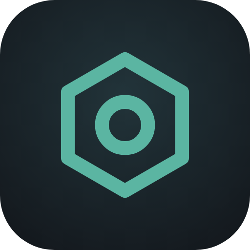
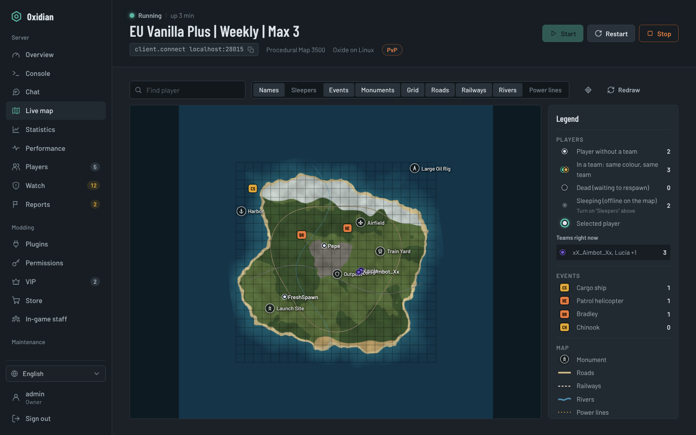
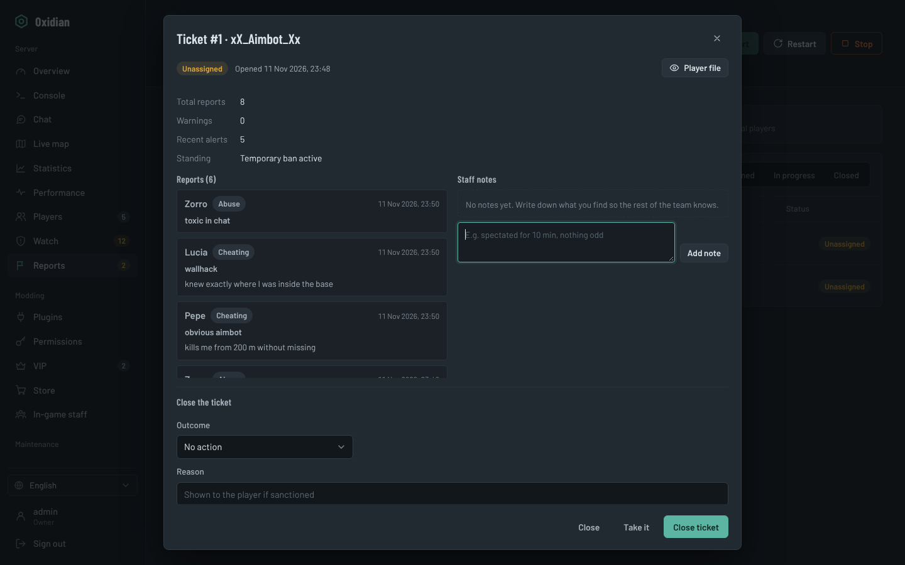
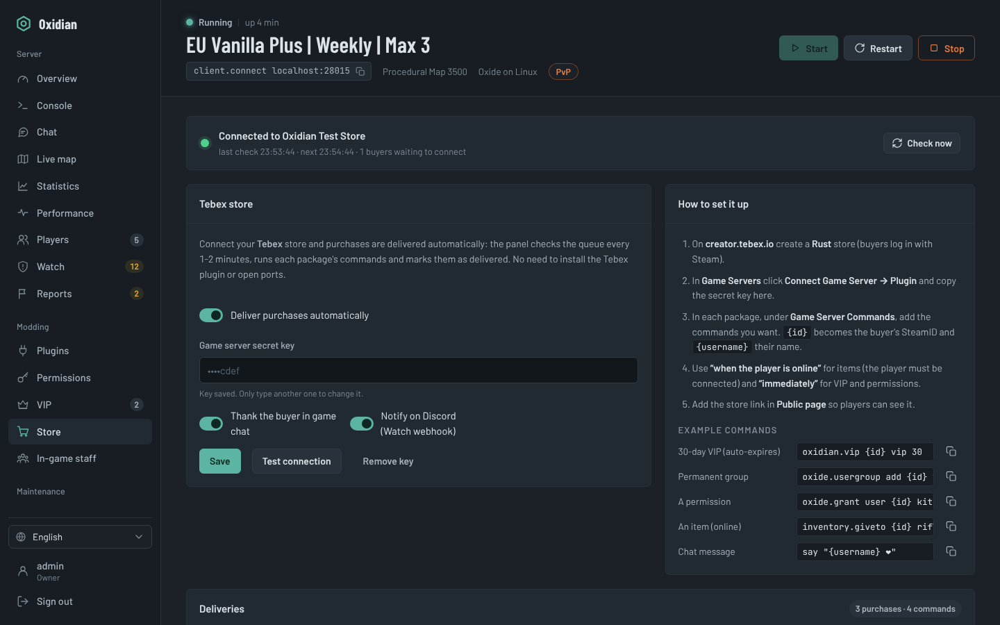
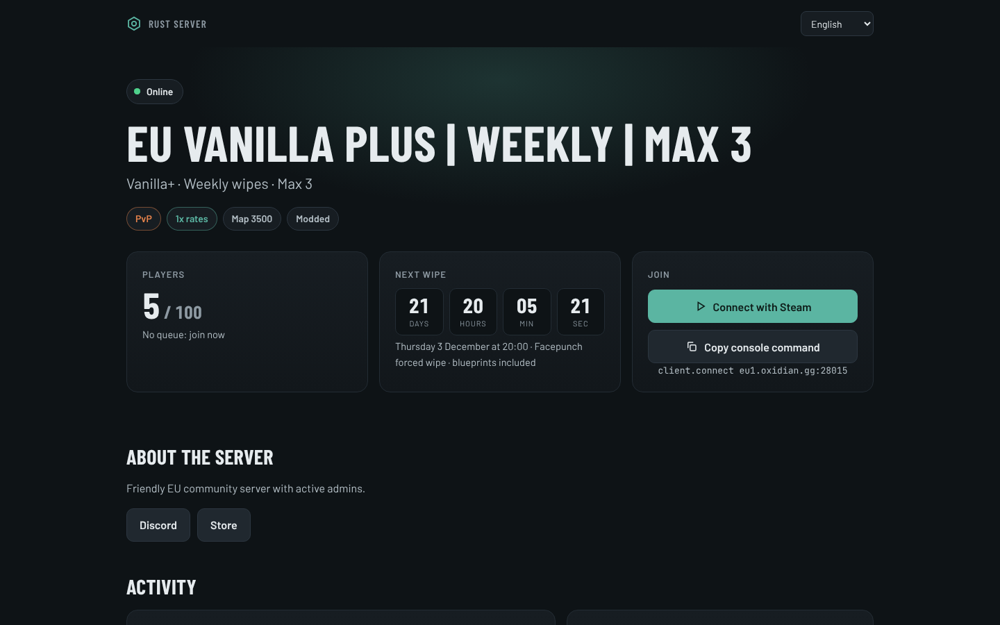
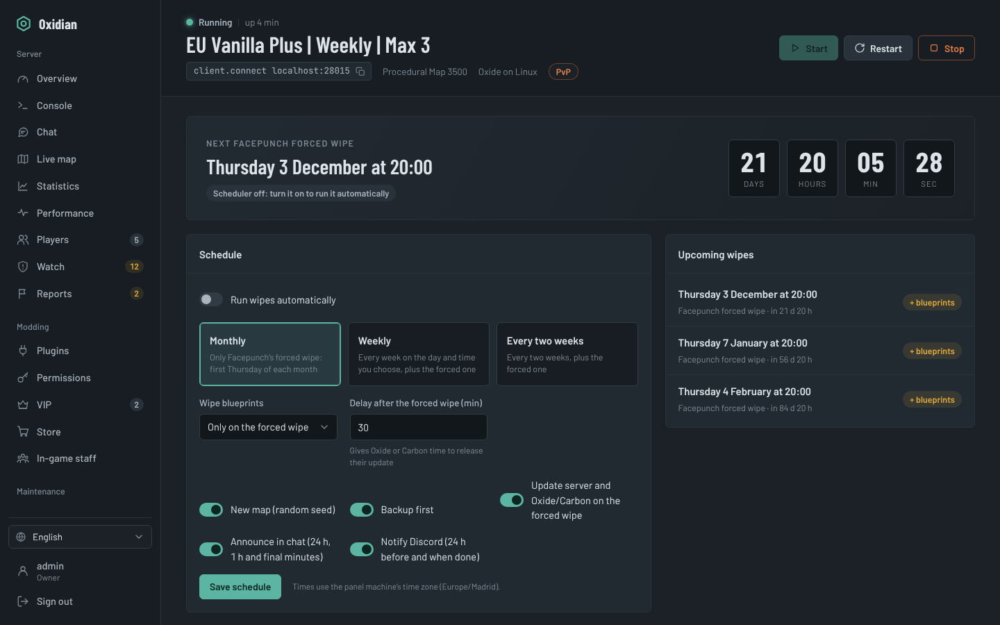
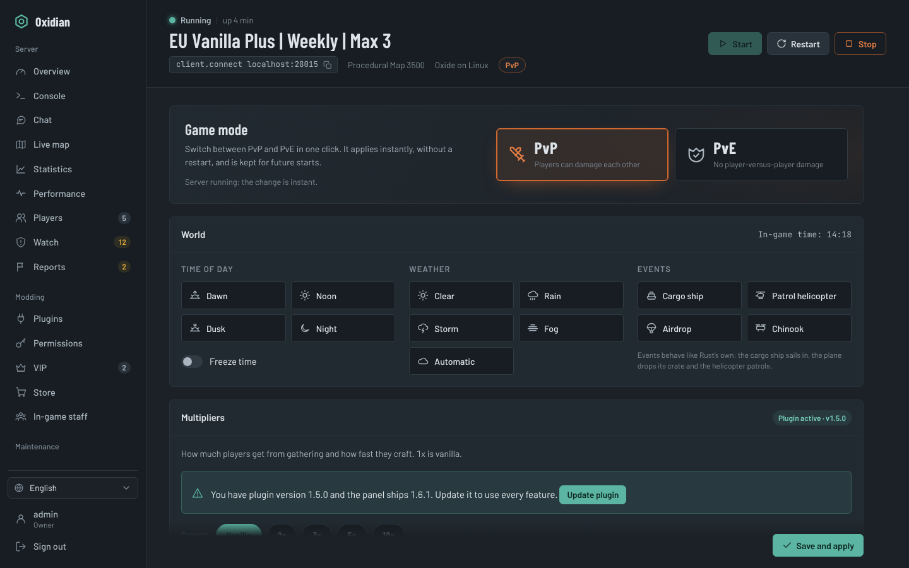
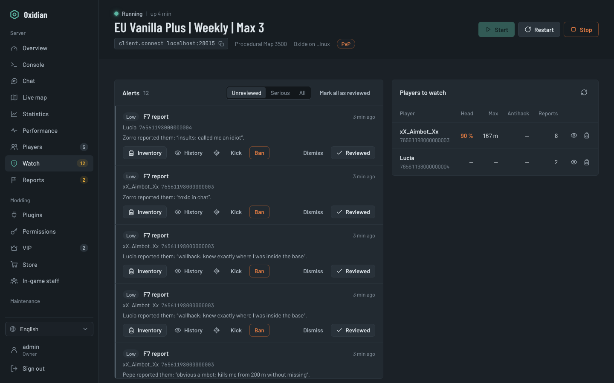

<p align="center"></p>

# Oxidian

[Website](https://jvlsile.github.io/oxidian/) · [English](README.md) · [Español](README.es.md)

[](https://github.com/jvlsile/oxidian/actions/workflows/ci.yml) [](https://github.com/jvlsile/oxidian/releases/latest) [](LICENSE)

**A free, self-hosted web panel to install, run, moderate and grow your Rust dedicated server.**
Windows and Linux. English, Spanish, Portuguese and French. No cloud account, no subscription: it runs on your own machine and your data stays with you.



> **🧪 Public beta.** Oxidian is new: things may break. If you find a bug, use **Report a bug** in the panel's side menu or [open an issue](https://github.com/jvlsile/oxidian/issues/new/choose); it helps a lot.

> Oxidian is free and open source (MIT). If it saves you time, you can support development on [Ko-fi](https://ko-fi.com/oxidian) ❤

---

## Why Oxidian

Most Rust admins juggle several tools: one to install the server, a paid RCON dashboard, a Discord bot, a store plugin and a pile of scripts for wipes. Oxidian puts all of it in one panel:

- **Set up**: installs SteamCMD, the server, and Oxide or Carbon in one click, with a real progress bar.
- **Run**: live console, scheduled restarts with warnings, backups, and a wipe planner that knows Facepunch's forced wipe.
- **Moderate**: F7 report tickets, an in-game `/staff` menu, a chat filter that blocks messages before they're sent, warnings with automatic sanctions, cheat alerts and Steam profile checks.
- **Grow**: a public server page with a "Connect" button, a two-way Discord bot, Tebex store delivery and VIP that expires on its own.

## Features

| | |
|---|---|
| **Existing & rented servers** | Import a server you already have on the same machine (reads your `.bat`/`.sh`, keeps your map and plugins) or connect to a **rented server over RCON** with just the IP, port and password. Add FTP/SFTP access to manage its plugins too. |
| **Installer** | SteamCMD, Rust (`public` / `staging` / `aux`), Oxide or Carbon in one click, or back to vanilla. Progress, speed and ETA. |
| **Dashboard** | Players and queue, FPS, entities, CPU, RAM. Global message, save, restart with countdown warnings. |
| **Live map** | Players by team, sleepers, cargo / heli / Bradley / Chinook, roads, rails, rivers, power lines, monuments, grid and a legend. |
| **Console & chat** | Live server log with filters and RCON history. Global, team and private chat history with search; message players from the panel. |
| **Players & teams** | Kick, ban, owner/moderator, give items, inventory viewer with item icons. Team-size limit alerts. |
| **F7 report tickets** | Every in-game F7 opens a ticket, grouped by reported player. Assign, add staff notes, close with a sanction and thank the reporters. |
| **In-game staff (`/staff`)** | A UI inside Rust for your mods and admins: reports, warn, mute, kick, ban, teleport, heal, time, weather, events. Two levels, everything logged. |
| **Moderation** | Notes, warnings with automatic escalation, timed mutes and temp bans, word filter with wildcards. |
| **Watch** | Alerts for suspicious headshot rates, impossible distances, antihack violations, kill streaks, shared IPs and ban evasion. Steam checks (VAC, recent game bans, account age, private profile, hours). VPN, proxy, hosting-IP and country detection. |
| **Rates & world** | One-click PvP/PvE, gather / pickup / quarry / craft multipliers, decay, upkeep, radiation, time of day, weather and events. |
| **Wipe planner** | Facepunch forced wipe (first Thursday, 19:00 London) plus weekly or biweekly wipes, with countdown, chat and Discord warnings, backup, update and new seed. |
| **Statistics** | Players over time, peak hours heatmap, new vs returning players, playtime and kill rankings, per wipe or up to 90 days. |
| **Performance** | Startup timing by phase with tips to boot faster, low-FPS / high-RAM / frozen-server alerts and optional auto-restart. |
| **Discord bot** | Game chat ↔ Discord channel, `/status`, `/players`, `/wipe` (shown in each user's Discord language), plus staff commands (`/say`, `/kick`, `/ban`, `/vip`, `/tickets`). No extra dependencies. |
| **Public page** | A page for your players at `/server`: status, connect button, wipe countdown, rates, activity, map (without player positions), rules and links. |
| **Tebex store** | Purchases are delivered automatically over RCON: no Tebex plugin, no open ports. `oxidian.vip {id} vip 30` grants a VIP that expires on its own. |
| **VIP with expiry** | Put a player in an Oxide/Carbon group for N days. Optional queue priority. Removed automatically when it expires. |
| **Plugins & permissions** | uMod search and one-click install, upload `.cs`, enable/disable, reload, JSON config editor, update checks. Grant permissions and manage groups. |
| **Admins** | Multiple users with roles (owner, admin, moderator, viewer), two-factor authentication (TOTP) and an activity log of who did what. |
| **Built-in wiki** | Every feature explained inside the panel, in every language. |

<table>
<tr>
<td></td>
<td></td>
</tr>
<tr>
<td></td>
<td></td>
</tr>
<tr>
<td></td>
<td></td>
</tr>
</table>

More screenshots in [`docs/screenshots`](docs/screenshots).

## Requirements

- **Windows** 10/11 or Windows Server 2019+, **or Linux** (Ubuntu 22.04/24.04, Debian 12), 64-bit.
- **Node.js 18.20+** (20 or 22 LTS recommended) (the Windows installer installs it with winget if missing).
- About **12 GB of free RAM** for a 3500 map and **20 GB of disk**.

## Quick start

Download the [latest release](https://github.com/jvlsile/oxidian/releases/latest) (or `git clone https://github.com/jvlsile/oxidian.git`).

**Windows**

1. Extract it, for example to `C:\Oxidian`.
2. Right-click **`install-windows.ps1`** → **Run with PowerShell**. It installs Node.js and the dependencies, opens the firewall ports and can register the panel to start with Windows.
3. Open <http://localhost:8080> and create your owner account.

Next time, just double-click **`start-windows.bat`**.

**Linux**

```bash
cd oxidian
sudo bash install.sh
```

This creates a `rustserver` user, installs Node.js, runs the panel as a `systemd` service on port 8080 and opens the ports in `ufw`.

**Manual (any OS)**

```bash
npm install --omit=dev
npm start            # http://localhost:8080
```

**Already have a server?** In **Install**, pick **I already have one here** to import its folder, or **Rented server (RCON)** to connect to a server at a game host. See below.

**New server**: Install → Install server → (optional) Install Oxide or Carbon → set the name and map in Server settings → Start.
The built-in **Wiki** walks you through everything else.

## Existing and rented servers

**Same machine.** Install → *I already have one here*: point to the folder that contains `RustDedicated` and click **Detect**. Oxidian reads your start script (`.bat`, `.cmd`, `.sh`) and `server.cfg` to keep the same ports, identity, RCON password, name, map and seed, and keeps your other launch parameters. Nothing is reinstalled or deleted. If the server is already running, the panel attaches to it.

**Rented server (remote mode).** Install → *Rented server (RCON)*: enter the IP, RCON port and password from your host. Everything that works over RCON is available: console, players, chat, moderation, F7 tickets, `/staff`, watch, statistics, Discord bot, Tebex, VIP, rates, world controls and the public page. Installing, backups and wipes stay with your host.

**FTP/SFTP access (optional).** In remote mode, add your host's FTP, FTPS or SFTP details and the folder that contains `RustDedicated`, then press **Test**. The **Plugins** section then works as usual (uMod install, upload, enable/disable, config editor) and the panel uploads and updates `OxidianBridge.cs` itself. Without it, download `OxidianBridge.cs` from the panel and upload it to `oxide/plugins` or `carbon/plugins` with your host's file manager. Prefer SFTP: plain FTP sends the password unencrypted.

 Scheduled restarts warn players, save and shut the server down so your host can start it again.

## VPN and country detection

**Watch → VPN, proxy and country** checks each player's IP when they join, using [proxycheck.io](https://proxycheck.io) (free key, 1,000 queries a day) or ip-api.com (no key, non-commercial use only). For VPN/proxy, hosting IPs and country you can do nothing, alert or kick, with a country block or allow list and a whitelist of SteamIDs or IPs. Results are cached for 3 days in `data/ipcheck.json`.

## Updating

The panel checks this repository's releases every 6 hours and shows **New version** in the sidebar when one is out. It only notifies: nothing is downloaded or installed automatically. Turn it off in **Account → Panel updates** or with `OXIDIAN_NO_UPDATE_CHECK=1`.

To update, stop the panel, replace the files with the new release (keep your `data/`, `server/`, `steamcmd/` and `backups/` folders), run `npm install --omit=dev` and start it again.

## Ports

| Port | Protocol | Purpose |
|---|---|---|
| 28015 | UDP | Game |
| 28017 | UDP | Query (server browser) |
| 28016 | TCP | RCON: **don't open it**, the panel connects locally |
| 28082 | TCP | Rust+ companion app |
| 8080 | TCP | Web panel |

## The OxidianBridge plugin

With Oxide or Carbon, the panel installs and updates its companion plugin **OxidianBridge** automatically. It powers the live map, inventories, cheat detection, F7 tickets, rates, events, the chat filter, `/staff` and queue priority. It can only be used over RCON, never by players. Without a framework you still get the installer, console, players, chat, scheduled restarts, wipes, statistics, the Discord bot and the public page.

## Security

- Passwords hashed with `scrypt`, optional TOTP two-factor with recovery codes, `HttpOnly` + `SameSite=Strict` session cookie, login lockout after failed attempts.
- Permissions are enforced by the server, not just hidden in the UI. Every action is written to the activity log.
- Secrets (Steam API key, Discord token, Tebex key) are stored only in `data/config.json` and never sent back to the browser.
- To reach the panel from the Internet, put it behind HTTPS (Caddy, Nginx) or use a VPN / SSH tunnel:

  ```
  panel.example.com {
      reverse_proxy localhost:8080
  }
  ```

Found a vulnerability? See [SECURITY.md](SECURITY.md).

## Translations

The UI and the wiki live in `public/i18n/<code>.json`. To add a language, copy `en.json`, change `meta.code` and `meta.name`, translate, and run:

```bash
node tools/check-i18n.js
```

It appears in the language selector automatically. Pull requests with new languages are very welcome.

## Contributing

Bug reports, ideas and pull requests are welcome. Please read [CONTRIBUTING.md](CONTRIBUTING.md) first.

## Support the project

Oxidian is built in spare time and is free for everyone. If it helps you run your server:

- ⭐ Star the repository
- ☕ Support it on [Ko-fi](https://ko-fi.com/oxidian)
- 🗣️ Tell other server owners about it

## License

[MIT](LICENSE). Bundled fonts use the SIL Open Font License 1.1; dependencies have their own licenses. See [THIRD-PARTY-NOTICES.md](THIRD-PARTY-NOTICES.md).

*Rust is a trademark of Facepunch Studios. Oxidian is an independent project and is not affiliated with or endorsed by Facepunch, Valve, uMod, Carbon or Tebex.*
